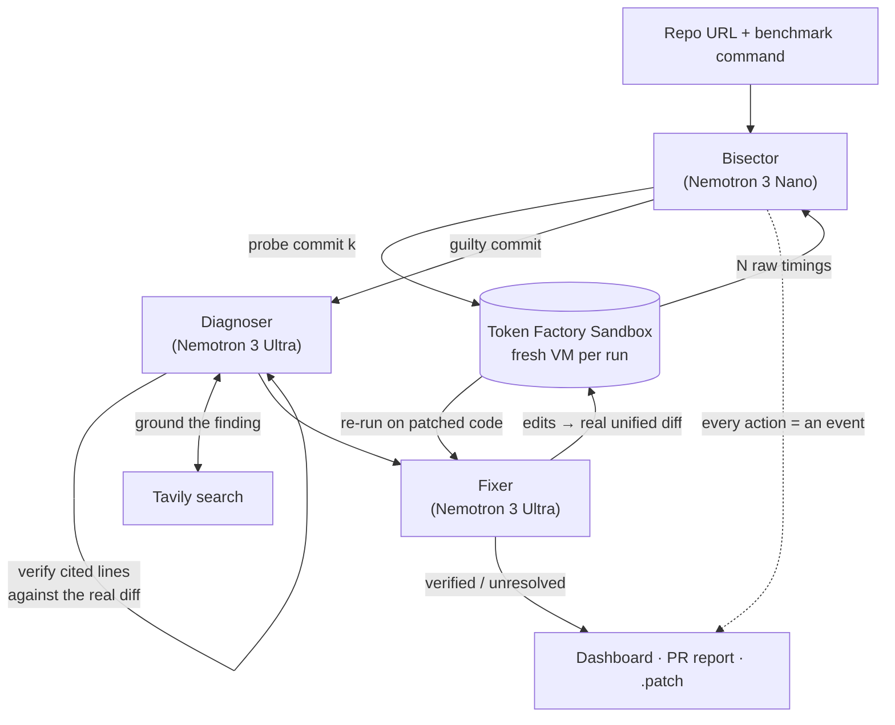

<div align="center">

<picture>
  <source media="(prefers-color-scheme: dark)" srcset="assets/logo/svg/culprit-logo-on-dark.svg">
  <source media="(prefers-color-scheme: light)" srcset="assets/logo/svg/culprit-logo.svg">
  
</picture>

### Finds the exact commit that made your code slower, explains why, and proves the fix by running it again.

[](LICENSE)
[](https://nebiusglobalaihackathon.devpost.com/)
[](https://nebiusglobalaihackathon.devpost.com/)
[](#which-ai-models-we-use-and-why)

**Live demo:** [culprit-ecru.vercel.app](https://culprit-ecru.vercel.app/) · **License:** [MIT](LICENSE) · Built for the [Nebius × NVIDIA Global AI Hackathon](https://nebiusglobalaihackathon.devpost.com/) (Coding & Agentic Engineering track)

</div>

---

## Contents

1. [Read this first: what we could and couldn't test](#read-this-first-what-we-could-and-couldnt-test)
2. [The problem](#the-problem)
3. [What Culprit does](#what-culprit-does)
4. [Which AI models we use, and why](#which-ai-models-we-use-and-why)
5. [How it works, step by step](#how-it-works-step-by-step)
6. [The dashboard](#the-dashboard)
7. [Our honesty rules](#our-honesty-rules)
8. [Quick start (no API keys needed)](#quick-start-no-api-keys-needed)
9. [Running with real Nemotron and Token Factory](#running-with-real-nemotron-and-token-factory)
10. [Settings](#settings)
11. [Using Culprit on your own repo](#using-culprit-on-your-own-repo)
12. [API](#api)
13. [Project layout](#project-layout)
14. [Testing](#testing)
15. [Hackathon notes](#hackathon-notes)
16. [Known limitations](#known-limitations)
17. [Security](#security)
18. [Contributing and license](#contributing-and-license)

---

## Read this first: what we could and couldn't test

We could not get access to Nebius Token Factory during the hackathon. **So Culprit has never been run against a live Nebius account.** We'd rather tell you that up front than have you find out.

Here's what happened. Token Factory needs a payment card to activate an account, and I'm a college student without one. I asked the Nebius team on the hackathon Discord whether this could be handled another way. The answer was that the card requirement applies to everyone and that they can't verify people by hand. I understand why they have that rule, so I'm simply being clear about what it means for this project.

| Part of the project | Status |
| --- | --- |
| Git, bisecting, benchmarks, profiling, patching, citation checks, patch review, regression-test logic | **Really tested.** It runs for real in offline mode and in the test suite, using real git repos and real sandbox processes. |
| Token Factory connection (chat calls, sandbox API, model-catalog check) | **Written from Nebius's public docs and tested with fake HTTP responses only.** |
| Live Nemotron 3 Nano and Ultra answers | **Seen, but through NVIDIA's hosted API, not Nebius.** Our hosted demo calls both models at `integrate.api.nvidia.com` (the same OpenAI-style API shape). Replies parsed as the JSON we expect, with Nano taking about 1 to 1.6 s and Ultra about 5 to 7 s per call. We have not seen them on Nebius. |
| Token Factory Sandboxes | **Never run.** The hosted demo uses the local sandbox. The request and response shapes are unconfirmed. |
| Nemotron model IDs | **Work on NVIDIA's API:** `nvidia/nemotron-3.5-lightning-30b-a3b` (Nano) and `nvidia/nemotron-3-ultra-550b-a55b` (Ultra). **Unconfirmed on Nebius,** which lists the family under other spellings. The `/preflight` check exists to sort this out on your first run. |
| Tavily search | **Real code, no stand-in.** It calls Tavily's API whenever a key is set, including in offline mode. [UPDATE after your test: say here whether you ran it with a key and saw sources in the terminal.] |

**What this means in practice.** The Nemotron code has been seen working against NVIDIA's own API. The Nebius-specific parts (Token Factory endpoint, sandboxes, Nebius model IDs) are real and complete, but nobody has watched them work yet. Anything marked "offline" in the app runs the same pipeline, except that the AI roles are replaced by small, clearly labeled stand-ins. Unless we say otherwise, every number and video we show comes from offline mode. Everything else in offline mode is real: the git history, the sandbox runs, and every benchmark time.

**If you have a Token Factory key,** follow [Running with real Nemotron and Token Factory](#running-with-real-nemotron-and-token-factory). If something breaks, please open an issue with the `/preflight` output and the event log. That would help us more than anything.

---

## The problem

Slowdowns hide in harmless-looking commits. Something like *"refactor: simplify order summary loading"* can quietly make a hot code path 30 times slower.

Finding the guilty commit means running `git bisect` by hand and timing each candidate. Fixing it means trusting a guess. Most teams only find out when a user complains. And most "AI debugging" demos hand you an answer with no proof behind it.

## What Culprit does

You give Culprit **a repository** and **a benchmark command**. Then it:

1. **Bisects** the history. It times each candidate commit in its own fresh, isolated sandbox, and finds the exact commit where the benchmark got slower than your threshold.
2. **Measures, then explains.** It profiles the benchmark on the last good commit and on the guilty one, so the explanation can quote real numbers (like "`query` went from 6 calls to 186"). Then Nemotron 3 Ultra explains the cause and must point to the exact lines responsible. Each cited line is checked against the real diff. A Tavily web search backs up the finding.
3. **Fixes it.** Ultra proposes an exact edit, which Culprit turns into a real patch. On Token Factory it tries **three different fixes at once**, times each in its own VM, and keeps the best one that actually worked.
4. **Proves it.** The benchmark runs again on the patched code. The fix counts as **"verified" only if that re-run really came back within your threshold.**
5. **Locks it in.** Ultra writes a small regression test that counts calls instead of measuring time (for example, "`query` is called at most 124 times"). The sandbox runs it twice: it must fail on the slow commit and pass with the fix. If it can't do both, Culprit ships no test and says why.
6. **Shows its work live.** Every git call, sandbox run and model request streams to a dashboard, with the raw responses one click away. You can export a PR-ready write-up and a real `.patch` file.

> The one promise that matters: **a fix is only called "verified" if a sandbox re-run of the patched code really passed.** The whole project is built around being able to prove that.

### Example: the bundled demo repo

| | |
| --- | --- |
| Repo | A 20-commit sample "orders-service" with real git history |
| Guilty commit | `refactor: simplify order summary loading`. One batched query became one query per order (a classic "N+1" problem). |
| Benchmark | `python bench.py`: about **297 ms** while broken, about **10 ms** after the verified fix (offline mode) |
| Search cost | Finds the culprit by timing about log₂(n) commits instead of all 20 |

---

## Which AI models we use, and why

Culprit uses two NVIDIA Nemotron models on purpose. A small, fast one handles the frequent, simple decisions. A large one handles the few steps that need real reasoning.

| Model | What it does | Why this model |
| --- | --- | --- |
| **Nemotron 3 Nano** (30B-A3B) | **Bisect decisions:** for every timed commit, says `clean`, `regressed`, or `inconclusive` (run more). **File triage:** if the guilty commit touches 4+ files, ranks them from most to least likely cause. **Patch review:** flags fixes that look like they cheat the benchmark (advisory only). | These are frequent, speed-sensitive calls, so a small fast model fits. Nano makes most of the calls (about 70% in the bundled demo). |
| **Nemotron 3 Ultra** (550B-A55B) | **Diagnoser:** finds the root cause and cites the lines. **Fixer:** writes the edits, and retries with feedback if they fail. **Test writer:** writes the regression test. | Only these steps need deep reasoning and a long context window, so the big model is used only here. |

All model calls go through Nebius Token Factory's OpenAI-compatible API (`https://api.tokenfactory.nebius.com/v1`). Token counts in the dashboard come from the API's own `usage` numbers, never from estimates.

**We don't trust Nano blindly.** Culprit also does the plain math (is the median beyond the threshold?). If Nano and the math disagree, the math wins, and the terminal shows an `arithmetic override` so you can see it. This happened for real on our hosted demo: Nano called a commit that was only about 1% slower "regressed", and the math overruled it.

### Token Factory Sandboxes

Each candidate commit, and each patched re-run, runs in its own fresh, disposable, VM-isolated sandbox. This gives you:

- **Fair numbers:** no leftover state or warm caches between runs.
- **Safety:** untrusted code from other people's repos never touches your machine.
- **Real measurements:** every number on the chart is wall-clock time from a real run.

Installed dependencies are cached by lockfile hash, so Culprit doesn't reinstall the same packages for every commit.

### Tavily (web search)

After a diagnosis, Culprit searches Tavily for the root-cause category and the code pattern it found. It attaches the sources along with Tavily's own relevance score and snippet. Anything scoring below `TAVILY_MIN_SCORE` (default `0.2`) is dropped. **If nothing relevant comes back, Culprit doesn't force a citation.** The query, the kept sources, their scores and the number dropped all show in the live terminal.

### Where to find each one in the code

| Technology | Files |
| --- | --- |
| Nemotron 3 Nano | `backend/bisector.py`, `backend/models.py` |
| Nemotron 3 Ultra | `backend/diagnoser.py`, `backend/fixer.py`, `backend/models.py` |
| Token Factory Sandboxes | `backend/sandbox_client.py` (`TokenFactorySandbox`) |
| Tavily | `backend/tavily_client.py` |
| Model-catalog check | `backend/preflight.py` |

---

## How it works, step by step



### Step 1: Find the commit (bisect)

- **Check the end of the range first**, like `git bisect` does. If the newest commit isn't slow, the honest answer is "no regression in this range", and that costs **one** probe instead of about log₂(n).
- **Each probed commit** gets a fresh sandbox and `N` benchmark runs (default 5). Culprit compares the **median** to the baseline, which is the known-good commit's median.
- **Nano gives a verdict,** the math double-checks it, and an `inconclusive` verdict triggers more runs.
- **Several commits at once (parallel search).** On Token Factory, every probe is its own VM, so Culprit can time several commits at the same time without them disturbing each other. With `P` probes per round, the search window shrinks by `P+1` instead of 2. For example, 3 at a time finds the culprit among 63 commits in 3 rounds instead of 6. You use more sandbox runs but wait much less. The answer is the same as a one-at-a-time search (we tested this exhaustively). The dashboard shows each round and the speed-up you actually got. On the **local** sandbox it stays one-at-a-time, because probes would share one CPU and ruin each other's timings.
- **You get** the earliest slow commit, the full timeline, and every raw run.

### Step 2: Explain why (diagnose)

Ultra receives the guilty diff, the surrounding file context, the commit message, and the before and after scores. It must pick one cause from a fixed list:

| Category | Meaning |
| --- | --- |
| `n_plus_one` | Repeated database or network calls added inside a loop |
| `lost_cache` | A cache was removed, invalidated or bypassed |
| `algorithmic_complexity` | Something got more complex (for example O(n) to O(n²)) |
| `blocking_call` | A new blocking operation on a hot path |
| `allocation_overhead` | Unnecessary memory allocation or serialization |
| `other` | Nothing fits cleanly, and Culprit says so honestly |

**Citations are checked.** Every cited line is compared to the real diff. If the lines aren't really in the diff, Culprit retries once, then downgrades the answer to `other` instead of shipping it.

### Step 3: Fix it and prove it

- Ultra returns exact-text edits (`file` / `old` / `new`) instead of hand-written diffs, because models are unreliable at counting diff line numbers. `patcher.py` turns the edits into a real unified diff and **rejects any `old` text that doesn't match the file exactly once**.
- The patched code is timed the **same way** as the bisect (same `N`, same statistic).
- Culprit gets up to **3 attempts**. A failed attempt feeds its result back to the model. A patch that **crashes** feeds back the error and is shown with **no score**, because nothing was measured.
- The final result is `resolved` only after a real passing re-run. Otherwise it's `unresolved_diagnosis_only`, with every attempt listed.

### The live event stream

Every action becomes an event, written by the code that did the thing, at the moment it did it. Nothing is scripted or replayed. Long operations show up as live spinners. Model-call events include the exact request, the raw response, the latency, the retry count and the API `usage`. See `docs/AGENT_SPECS.md` §5.

---

## The dashboard

The dashboard is a Next.js app. It's built so that someone with no context can see *what got slower, why, and whether it's fixed* in about a minute.

| Panel | What you see |
| --- | --- |
| **Live terminal** | Every row is a real event: git calls, sandbox runs landing as colored bars, and Nemotron requests. Expand any request to see the exact prompt, payload and **raw response**. Running operations show live timers. You can filter, and download the full `.jsonl`. |
| **Bisect scanner** | One cell per commit. *Solid* means it was timed in a sandbox. *Faint* means it was ruled out by reasoning only. You watch the suspects shrink to the guilty commit. A cancelled search is never painted "all clean". |
| **Evidence chart** | The baseline, the threshold band, **every raw run** behind each median, and the verified fix landing back inside the band. |
| **Diagnosis** | The category, the explanation, and the cited lines highlighted in the **real diff**. Also the citation check result and the Tavily sources with scores. |
| **Fix** | Every attempt, its patch, its measured score (or none, if it crashed) and the verdict. |
| **Under the hood** | Calls, latency and tokens per model, plus sandbox runs and searches, added up from the event stream. Shows the Nano/Ultra split. |
| **Export** | A PR-ready write-up (`report.md`) and a real `.patch`. The report can only claim what the job actually proved. |
| **History and cancel** | All jobs and their event logs are saved in SQLite. Cancel stops cleanly at the next checkpoint. |

It has light and dark themes and works on mobile. Empty, failed and cancelled states are handled properly.

---

## Our honesty rules

These are enforced in the code (see rule 1 in `AGENTS.md`), not just promised.

- **Numbers come only from real runs.** "Verified" mirrors a real sandbox result and nothing else.
- **A fix that doesn't work is reported as unresolved,** with all its attempts. It's never dressed up.
- **A crashing patch is a failed attempt with no score.**
- **Profiling data is measured or missing, never guessed.** For a non-Python benchmark, a crash, or a backend that can't profile, the profile is simply skipped and can't fail a job. Set `CULPRIT_PROFILE=0` to turn it off.
- **A fast but broken patch is not a fix.** If you pass a `test_command`, it must pass on the slow commit (so it can actually judge) *and* on the patched code. If not, the attempt is rejected, the failure output goes back to Nemotron, and the job never says "verified". If your suite is already failing or can't run, Culprit says so and verifies on speed only.
- **Trying several fixes can't hide a bad one.** Only a candidate whose own sandbox re-run came back within the threshold (and passed your tests, if you gave a test command) can win. The winner is the best *measured* one among them. If none works, the job is unresolved and lists everything. Locally, fixes are *proposed* in parallel but *timed* one at a time, because running benchmarks together on one CPU would corrupt the timings.
- **Patch review is advisory and decides nothing.** Nano screens every candidate for ways a "fix" can fool a benchmark: special-casing its inputs, hard-coding results, skipping work or checks, swallowing errors. Its verdict appears next to the attempt, but it can't verify a fix, un-verify one, or pick the winner. The sandbox does all of that. Two checks are plain code with no model: with a `test_command`, a patch that edits a test file is rejected before it runs, and a patch that edits the benchmark script itself is always flagged. Set `CULPRIT_PATCH_REVIEW=0` to turn off Nano's part.
- **A regression test ships only if it was proven.** It must fail on the slow commit and pass with the fix, in real sandbox runs. It's also run on the last good commit and flagged if it isn't green there. This step is extra evidence and can never fail a job or change its result. Set `CULPRIT_GUARD_TEST=0` to turn it off.
- **Bad citations are retried once, then downgraded to `other`.**
- **Low-relevance Tavily results are dropped, not cited.**
- **Infrastructure failures fail the job loudly.** Only a *commit* that can't be built or run is skipped, visibly, and never given a verdict.
- **Offline mode is labeled everywhere:** every event, job record, page and report. It's never turned on by accident. A missing API key in normal mode is a hard error.

---

## Quick start (no API keys needed)

You need **Python 3.11+**, `git`, and **Node.js 20+** with npm.

```bash
# 1. get the code
git clone https://github.com/vybex-dev/Culprit.git && cd Culprit

# 2. install the backend and frontend dependencies
make install                      # or follow the manual steps below

# 3. terminal 1: start the backend in offline mode
make dev-backend                  # same as: cd backend && CULPRIT_OFFLINE=1 python api.py

# 4. terminal 2: start the dashboard
make dev-frontend                 # same as: cd frontend && npm run dev
```

Open **http://localhost:3000** and press **Run the live demo**. In about a minute you'll watch a real git bisect of a 20-commit sample repo. You'll see each benchmark run land as it happens, the search window shrink onto the guilty commit, a diagnosis with cited lines, and a patch verified by a real re-run (about 297 ms down to about 10 ms).

<details>
<summary>Manual install (without <code>make</code>)</summary>

```bash
cd backend
pip install -r requirements.txt
CULPRIT_OFFLINE=1 python api.py        # serves on http://127.0.0.1:8000

# in another terminal
cd frontend
npm install
cp .env.example .env.local             # NEXT_PUBLIC_API_BASE_URL=http://localhost:8000
npm run dev                            # http://localhost:3000
```

</details>

### What "offline mode" is, and isn't

`CULPRIT_OFFLINE=1` lets anyone run the whole pipeline without keys.

- **Real:** git, the sandbox processes, and every benchmark number.
- **Stand-ins:** the Nemotron roles (Nano verdict, Ultra diagnose, Ultra fix, and the test writer and patch reviewer). A small deterministic stand-in in `backend/offline.py` plays their part, and the UI says so everywhere.
- **Tavily is not faked.** If `TAVILY_API_KEY` is set, Culprit makes real Tavily searches even in offline mode. Without a key, the search step is skipped and the terminal says so.

Real evaluations should use live mode.

---

## Running with real Nemotron and Token Factory

### 1. Get your credentials

| You need | Where to get it |
| --- | --- |
| `NEBIUS_API_KEY` | [Nebius Token Factory](https://tokenfactory.nebius.com/). It's used for both model calls and sandboxes. |
| `CONTREE_PROJECT` | A project ID with sandbox access |
| `CONTREE_IMAGE` | An image UUID or `tag:…` that has `python3`, `git` and `pip` |
| `TAVILY_API_KEY` | [tavily.com](https://tavily.com/) |

### 2. Set up and start

```bash
cd backend
cp .env.example .env
# edit .env: NEBIUS_API_KEY, CONTREE_PROJECT, CONTREE_IMAGE, TAVILY_API_KEY
# USE_TOKEN_FACTORY=1 is already set in the example
python api.py
```

```bash
cd frontend && npm install && cp .env.example .env.local && npm run dev
```

### 3. Check everything before you spend anything

Open **http://localhost:3000/new**. The **Backend ready** panel calls `GET /preflight`, which checks against the **live Token Factory model catalog** that:

- your Nemotron model IDs exist (and if they don't, it lists the real Nemotron IDs available to you),
- your API key is accepted,
- the sandbox project and image are set,
- the Tavily key is there.

This way a bad setup shows up *before* a run, not three minutes into one. It matters because Nebius lists the Nemotron family under more than one spelling. Set `NEMOTRON_NANO_MODEL_ID` and `NEMOTRON_ULTRA_MODEL_ID` to whatever preflight reports.

---

## Settings

Everything is an environment variable, read from `backend/.env` (real shell variables win). See [`backend/.env.example`](backend/.env.example).

| Variable | Default | What it does |
| --- | --- | --- |
| `CULPRIT_OFFLINE` | unset | `1` means no keys needed: real git and benchmarks, labeled stand-in models |
| `NEBIUS_API_KEY` | none | Token Factory key (model calls **and** sandboxes) |
| `NEBIUS_API_BASE_URL` | `https://api.tokenfactory.nebius.com/v1` | Model-call endpoint |
| `NEMOTRON_ULTRA_MODEL_ID` | `nvidia/nemotron-3-ultra-550b-a55b` | Model for diagnosing and fixing |
| `NEMOTRON_NANO_MODEL_ID` | see `backend/models.py` | Model for bisecting. **Confirm with `/preflight`.** |
| `USE_TOKEN_FACTORY` | unset | `1` runs benchmarks in Token Factory Sandboxes. Unset uses the local sandbox. |
| `CONTREE_PROJECT` | none | Sandbox project ID (`NEBIUS_AI_PROJECT` also works) |
| `CONTREE_IMAGE` | none | Sandbox image UUID or `tag:…` (needs python3, git, pip) |
| `CONTREE_URL` | `https://api.tokenfactory.nebius.com/sandboxes` | Sandbox API base URL |
| `TAVILY_API_KEY` | none | Key for grounding search |
| `TAVILY_MIN_SCORE` | `0.2` | Results scoring below this are dropped, never cited |
| `REGRESSION_THRESHOLD_PCT` | `15` | How much slower than baseline counts as "regressed" |
| `BENCHMARK_N_RUNS` | `5` | Benchmark runs per probed commit |
| `BISECT_PARALLELISM` | `auto` | Commits probed at once. `auto` is 3 on Token Factory and 1 locally. A number (max 6) forces it. |
| `FIX_CANDIDATES` | `auto` | Different fixes proposed per round. `auto` is 3 on Token Factory and 1 locally. A number (max 5) forces it. Up to 3 rounds. |
| `CULPRIT_TRIAGE` | `1` | `0` turns off Nano's file ranking for big guilty commits |
| `CULPRIT_PATCH_REVIEW` | `1` | `0` turns off Nano's advisory patch review (the test-file and benchmark-edit rules always apply) |
| `AUTO_RANGE_COMMITS` | `30` | If you give no range, search the last N first-parent commits |
| `MAX_CONCURRENT_JOBS` | `2` | Extra jobs really wait in `queued` |
| `CORS_ALLOWED_ORIGINS` | `http://localhost:3000` | Comma-separated dashboard origins |
| `HOST` / `PORT` | `127.0.0.1` / `8000` | Where the server listens |
| `CULPRIT_DB` | SQLite at `backend/.data/culprit.db` | Set to `memory` to save nothing |
| `CULPRIT_DATA_DIR` | `backend/.data` | Where the SQLite file lives |
| `CULPRIT_ALLOW_LOCAL_REPOS` | unset | Allow local-path repos while `USE_TOKEN_FACTORY=1` |
| `CULPRIT_MAX_DIFF_CHARS` / `CULPRIT_MAX_CONTEXT_CHARS` | `150000` / `300000` | Caps so one huge diff can't overflow the model's context |

For the frontend, set `NEXT_PUBLIC_API_BASE_URL` (default `http://localhost:8000`) in `frontend/.env.local`.

---

## Using Culprit on your own repo

Open **/new** in the dashboard, or call the API directly:

```bash
curl -X POST http://localhost:8000/analyze \
  -H 'Content-Type: application/json' \
  -d '{
        "repo_url": "https://github.com/your-org/your-repo.git",
        "benchmark_command": "python bench.py",
        "commit_range": ["v1.4.0", "main"],
        "test_command": "pytest -q"
      }'
# → {"job_id": "…"}
# test_command is optional. If you give it, a fix only counts as verified if it also passes your tests.
# It runs inside the sandbox, so list your test dependencies in requirements.txt.
```

**Your benchmark command should:**

- run from the repository root and finish in **seconds, not minutes** (isolate the hot path you care about),
- print the metric as a number the harness can read (lower is better, usually wall-clock time),
- be steady enough that run-to-run noise is smaller than your threshold.

**The commit range is optional.** The ends can be SHAs, tags or branches. Leave it out to search the last `AUTO_RANGE_COMMITS` commits.

Then watch `/job/<job_id>`, and download `/jobs/<job_id>/report.md` and `/jobs/<job_id>/fix.patch`.

---

## API

| Endpoint | What it does |
| --- | --- |
| `POST /analyze` | Takes `{repo_url, benchmark_command, commit_range?, test_command?}` and returns `{job_id}` |
| `POST /demo` | Starts a job on the bundled sample repo |
| `GET /jobs` | Job history |
| `GET /jobs/{id}` | Full job state, plus derived `metrics` |
| `GET /jobs/{id}/events?after=<seq>` | Live event stream, paged by cursor: `{events, next, done, status}` |
| `POST /jobs/{id}/cancel` | Cancels cleanly (checked between probes, run rounds and fix attempts) |
| `GET /jobs/{id}/report.md` | The PR-ready write-up |
| `GET /jobs/{id}/fix.patch` | The verified (or attempted) patch |
| `GET /jobs/{id}/guard-test.py` | The regression test, only if proven to fail on the slow commit and pass with the fix |
| `GET /config` | Current mode (live or offline) |
| `GET /preflight` | Readiness checks against the live model catalog |
| `GET /health` | Is the server alive? |

**Job statuses:** `queued → bisecting → diagnosing → fixing → done`, or `failed` / `cancelled`.
**Final results:** `resolved`, `unresolved_diagnosis_only`, or "no regression in range".

We also wrote up a regression in a real open-source project (`tabulate`, 205 commits, measured and bisected) in [`docs/REAL_WORLD_CASE.md`](docs/REAL_WORLD_CASE.md).

The data models are in `backend/schema.py`. The event list and agent JSON formats are in [`docs/AGENT_SPECS.md`](docs/AGENT_SPECS.md).

---

## Project layout

```
                ┌────────────────────────── dashboard (Next.js) ──────────────────────────┐
                │  scanner · evidence chart · live terminal · diagnosis · export · history │
                └───────────▲───────────────────────────────▲──────────────────────────────┘
              GET /jobs/{id} (state)            GET /jobs/{id}/events?after=seq (live stream)
                ┌───────────┴───────────────────────────────┴──────────────┐
                │  api.py — FastAPI · job runtime · SQLite · cancel · limits│
                └───┬───────────────────────────────────────────────────┬───┘
                    │ events.py: every action → append-only event       │
     ┌──────────────┼───────────────┬──────────────────┬────────────────┘
     ▼              ▼               ▼                  ▼
 bisector.py    diagnoser.py     fixer.py         sandbox_client.py
 Nano per       Ultra + citation Ultra edits →    Token Factory VM ─ or ─
 commit,        check + Tavily   patcher.py →     local git worktree
 log₂(n) probes                  real re-run
```

```
backend/
  api.py            FastAPI app, job runtime, SQLite-backed history
  schema.py         data models and SQLite stores
  events.py         append-only live event stream
  bisector.py       binary search; Nano verdicts + math cross-check
  diagnoser.py      Ultra root cause + citation check + Tavily grounding
  fixer.py          Ultra edits + sandboxed verification loop (up to 3 attempts)
  patcher.py        exact-text edits → real unified diff (and new-file patches)
  guardtest.py      Ultra writes a regression test; the sandbox must prove it fails, then passes
  reviewer.py       test-file rule + benchmark-edit flag + Nano's advisory patch review
  sandbox_client.py Token Factory sandbox + local git-worktree sandbox (same interface)
  models.py         Nebius Token Factory / Nemotron client (retries, usage counting)
  tavily_client.py  Tavily client with a relevance floor
  preflight.py      readiness checks against the live model catalog
  report.py         PR-ready markdown write-up
  offline.py        labeled stand-in for the model roles
  demo_repo.py      builds the bundled sample git repo
  tests/            pytest suite (real git repos, real sandbox processes)
frontend/
  src/app/          pages: / · /new · /jobs · /job/[jobId]
  src/components/   dashboard panels (scanner, chart, terminal, diagnosis, fix, export …)
  src/lib/          terminal.ts + scanner.ts (pure and tested), polling hooks, types
  tests/            unit tests over a real captured job and event stream
docs/               PRD · TRD · AGENT_SPECS · PROJECT_PLAN · SUBMISSION · build-prompts/
demo_cases/         notes for real-world cases (templates, see limitations)
assets/logo/        logo, mark, favicons
```

**Tech stack:** Python, FastAPI, httpx, Pydantic, SQLite, structlog. Next.js 16, React 19, Tailwind CSS 4, TypeScript.

---

## Testing

```bash
make test               # everything
make test-backend       # cd backend && python -m pytest -q
make test-frontend      # npm test + typecheck + lint
make check              # tests + production build
```

- The backend tests use **real git repos and real sandbox processes**. Only the model roles are faked. The Token Factory HTTP parts (sandbox API, Nemotron calls, preflight) are tested with mocked HTTP.
- The frontend tests run against a **job and event stream captured from the real pipeline** (`frontend/tests/fixtures/`). If the backend's real output drifts from what the UI expects, they fail.
- The backend suite is slow because it builds real git repos. Give it a few minutes.

---

## Hackathon notes

**Event:** [Nebius × NVIDIA Global AI Hackathon](https://nebiusglobalaihackathon.devpost.com/) · **Track:** Coding & Agentic Engineering

| Requirement | Where it's covered |
| --- | --- |
| Runs on Nebius Token Factory with at least one NVIDIA open-source model | Built for it (Nemotron 3 Nano + Ultra, Token Factory Sandboxes), but **not run live because I couldn't activate a Token Factory account (it needs a payment card).** See [Read this first](#read-this-first-what-we-could-and-couldnt-test). |
| README explains Nemotron and Nebius usage | [Which AI models we use, and why](#which-ai-models-we-use-and-why) |
| Clear run instructions | [Quick start](#quick-start-no-api-keys-needed) and [Running with real Nemotron and Token Factory](#running-with-real-nemotron-and-token-factory) |
| Open-source license visible at the top | [MIT](LICENSE) |
| Demo | [culprit-ecru.vercel.app](https://culprit-ecru.vercel.app/), local build steps above, and a 3-minute video script in [`docs/SUBMISSION.md`](docs/SUBMISSION.md) |

**Judging criteria**

| Criterion | Where to look |
| --- | --- |
| Technological implementation | Nano/Ultra split with a math cross-check; citation checking; exact-text edits turned into a real diff; a fix loop that survives crashes; `git bisect`-style endpoint check; clean cancel; SQLite history; live event stream; preflight against the live catalog; many tests on real repos |
| Design | Scanner, evidence chart, live terminal, diff drill-down, export, history; light, dark and mobile; honest empty, failed and cancelled states |
| Potential impact | Slowdowns cost real engineering time. The PR report and `.patch` drop straight into code review. |
| Quality of idea | "Prove it with a re-run" is the one rule the whole product is built on |
| Best use of Tavily | Query, sources, relevance scores and a relevance floor, all visible in the terminal |

---

## Known limitations

Please read these before trusting a result.

- **The live Nebius path has never been validated.** We couldn't get Token Factory access (see [Read this first](#read-this-first-what-we-could-and-couldnt-test)). It's tested with mocked HTTP and written from Nebius's public docs. Model IDs and sandbox response shapes are unconfirmed, and `GET /preflight` is there to settle them on your first run.
- **We assume one clean switch from fast to slow** (clean, clean, regressed, regressed). Flaky or on-and-off histories can mislead a bisect. The scanner labels unmeasured commits as *inferred* for this reason.
- **Parallel search trades sandbox runs for waiting time.** It uses up to `P` probes per round, and some of those a one-at-a-time search wouldn't have needed. Its timings are only trustworthy when probes are isolated, so the default is 1 on the local sandbox, and forcing more there prints a warning.
- **Commits that can't run are skipped, not scored.** If a commit can't be built or run (a failing install, a crashing benchmark), Culprit steps over it like `git bisect skip` and tries its nearest runnable neighbor. It's shown as *skipped*, neither measured nor assumed clean. If the skips leave no single commit that can be named, the job fails and lists the suspects instead of guessing. The baseline and the end of the range must be runnable.
- **Noise is managed, not removed** (repeated runs plus the Nano and math cross-check). Very small slowdowns near the threshold need more runs.
- **Python first.** We chose depth in one ecosystem over breadth.
- **The bundled demo is constructed.** Its git history and measured slowdown are real, but it's a repeatable smoke test, not a substitute for real open-source cases. `demo_cases/` holds templates for those.
- **No login or rate limiting** on the API (see below).

## Security

- The **local sandbox runs benchmark commands on your own machine.** Use it only for development and offline demos, and never point it at untrusted input. For anything shared, use `USE_TOKEN_FACTORY=1`.
- Remote repo URLs are limited to `https` and `ssh`, and git option-injection is blocked. Local-path repos are refused when `USE_TOKEN_FACTORY=1` unless you set `CULPRIT_ALLOW_LOCAL_REPOS=1`.
- There is **no authentication or rate limiting.** If you deploy this publicly, put your own in front of it.
- Keep `backend/.env` out of version control (it's git-ignored), and rotate any key that has ever been exposed.

## Contributing and license

Issues and pull requests are welcome. If you're an AI coding agent working on this repo, read [`AGENTS.md`](AGENTS.md) first. Its non-negotiable rules are: never make up benchmark results, use one fresh sandbox per run, keep agent outputs on their documented JSON formats, keep the Nano/Ultra split, and make the Diagnoser cite diff lines. Design docs: [`docs/PRD.md`](docs/PRD.md), [`docs/TRD.md`](docs/TRD.md), [`docs/AGENT_SPECS.md`](docs/AGENT_SPECS.md).

Released under the **MIT License**. See [`LICENSE`](LICENSE).

---

<div align="center">
<sub>Built for the Nebius × NVIDIA Global AI Hackathon · Designed for NVIDIA Nemotron on Nebius Token Factory · Grounded with Tavily</sub>
</div>
